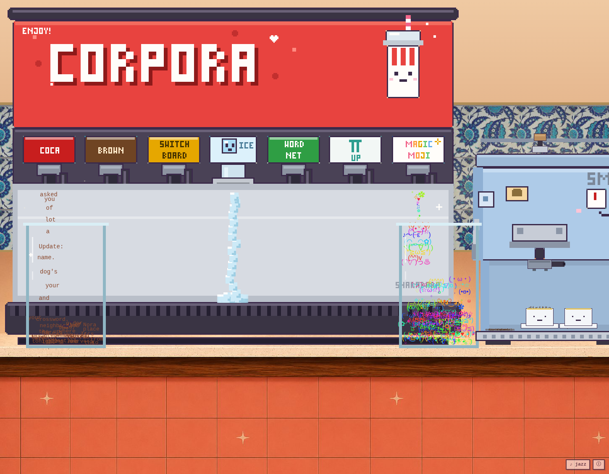
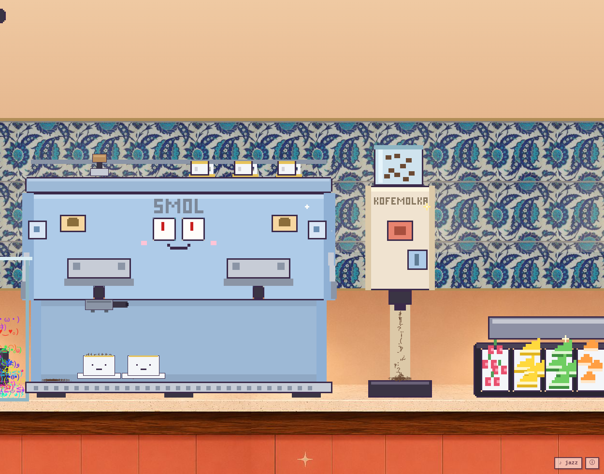
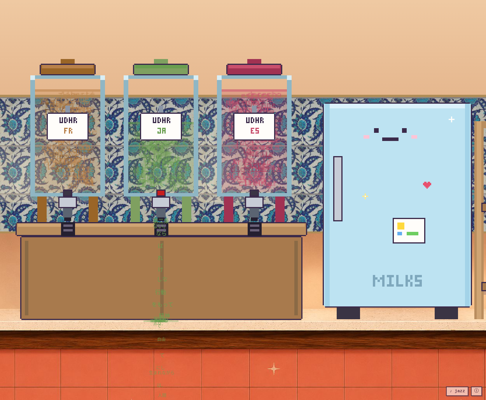
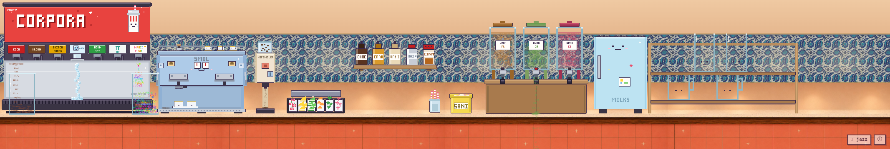

# corpora-cafe 🥤

A pixel drink counter where every tap pours a real linguistics corpus, word by word, with physics.

**[▶ Play it here](https://brezgis.github.io/corpora-cafe/)**

## What is this

A hard-pixel, early-2000s-web-style café built as one self-contained HTML file.
The soda fountain dispenses corpora. The espresso machine pulls timed shots of
Dante. The tea urns hold the Universal Declaration of Human Rights in three
languages, steeping as visible tokens. Everything you pour falls as words,
collapses into characters when it lands in a glass, and stacks into a drink
you can garnish, steam, slurp — or spill, and then mop up with the rag from
the SANI bucket. There are no instructions; poke at things.

## Quickstart

Open `index.html` in a browser. That's it — no build, no dependencies, no
network requests. (Or serve the folder with any static server.)

`♪ jazz` in the corner starts a little brushed piano trio — comping in
rootless voicings, a walking bass, brushes — generated live in your browser
with Web Audio. `ⓘ` has the credits.

## On tap

| Tap | Corpus |
|---|---|
| BROWN | [The Brown Corpus](https://en.wikipedia.org/wiki/Brown_Corpus) (1961), the original million-word corpus of American English: ~100 real sentences sampled across all 15 genres, opening with the Fulton County Grand Jury |
| COCA | in the spirit of the [Corpus of Contemporary American English](https://www.english-corpora.org/coca/): original lines written in its eight genres (COCA itself can't be redistributed) |
| SWITCHBOARD | [telephone speech](https://catalog.ldc.upenn.edu/LDC97S62), uh, you know [laughter]: original A:/B: exchanges in its transcription style, on its real call topics (also licensed, so not quoted) |
| WORDNET | [Princeton WordNet](https://wordnet.princeton.edu/) 3.0 synsets and glosses, with a few hypernym chains |
| πUP | [the digits of π](https://en.wikipedia.org/wiki/Pi), computed live (Machin's formula) so it really never repeats |
| MAGIC MOJI | [kaomoji](https://en.wikipedia.org/wiki/Kaomoji), rainbow-fresh (ノ◕ヮ◕)ノ*:・゚✧ — about seventy of them |
| espresso | Dante, [Divina Commedia](https://en.wikipedia.org/wiki/Divine_Comedy): all of *Inferno* I, shot after shot, then a few famous tercets through the last line of *Paradiso* |
| teas | the [UDHR](https://www.un.org/en/about-us/universal-declaration-of-human-rights) in French, Japanese, and Spanish: the same 18 articles in each, aligned like the parallel corpus it is (Japanese is word-segmented as it pours) |
| milks | [lorem ipsum](https://en.wikipedia.org/wiki/Lorem_ipsum) (MILK), the Cicero it was scrambled from, *De finibus* 1.10.32–33 (OAT, SOY), and H. Rackham's 1914 translation (UBE) |
| whip | three words of [Devo](https://en.wikipedia.org/wiki/Whip_It_(Devo_song)), floats as a cap |
| KOFEMOLKA | grinds words into punctuation |

Every dispenser keeps pouring from where it left off: sampled corpora
shuffle their sentences (none repeats until the whole bag has poured),
continuous texts run in order.

## More of the room

Everything is drawn at your screen's real pixel density, with the pixel art
snapped to whole device pixels, and the physics runs at a fixed 60 steps a
second whatever your display's refresh rate.

The backsplash is a real museum piece: [*Tile with 'Saz' Leaf Design*](https://www.metmuseum.org/art/collection/search/452854),
Iznik, ca. 1545–55, from The Met's open-access collection (public domain).

## License

[MIT](LICENSE)

---

a [sharabara](https://brezgis.github.io) production ♡
